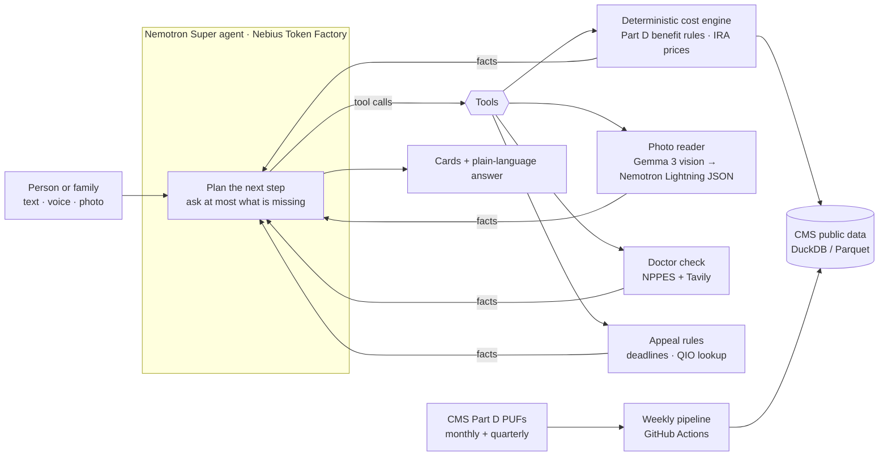

# Medicare Helper

**A free, neutral, privacy-first helper for people with Medicare and the families who help them.**
It compares every plan in a county against the medicines someone actually takes, checks their current plan for next year,
looks up doctors, screens for Extra Help, and, when a nursing home or rehab says Medicare will stop paying, turns the
notice into a deadline and a phone script for a fast appeal.

Built for the [Nebius x NVIDIA Global AI Hackathon](https://nebiusglobalaihackathon.devpost.com/) (Personal AI track ·
Best Use of Tavily). Agent and extraction run on **NVIDIA Nemotron** models served by **Nebius Token Factory**.

> Decision support only. Not an insurer, broker or enrollment service: no commissions, no ads, nothing to sell.
> Always confirm with the plan or 1-800-MEDICARE before enrolling.

**The AI never makes up a number.** Every dollar figure comes from a deterministic engine built on Medicare's public
files; the models only listen, read, extract and explain.

---

## Why

| | |
|---|---|
| **35.2M** people are in Medicare Advantage in 2026, 55% of those eligible | [KFF, 2026](https://www.kff.org/medicare/medicare-advantage-in-2026-enrollment-update-and-key-trends/) |
| **32** Medicare Advantage drug plans to choose from, on average, for 2026 | [KFF, Oct 2025](https://www.kff.org/medicare/medicare-beneficiaries-have-32-medicare-advantage-prescription-drug-plans-available-on-average-for-2026/) |
| **69%** of people with Medicare did not compare their options during open enrollment | [KFF, 2022 coverage year](https://www.kff.org/medicare/nearly-7-in-10-medicare-beneficiaries-do-not-compare-coverage-options-during-open-enrollment/) |
| **80.7%** of appealed prior-authorization denials were overturned, yet only **11.5%** were appealed | [KFF, 2024 data](https://www.kff.org/medicare/medicare-advantage-insurers-made-nearly-53-million-prior-authorization-determinations-in-2024/) |

The official tool (Medicare Plan Finder) is accurate but long and form-driven. Most help elsewhere comes from people
paid by insurers. Families end up guessing, or not choosing at all.

## What it does

1. **Tell it, or show it.** Type or speak naturally ("Mom takes Eliquis twice a day, lives in Orange County"), or take a
   photo of a pill bottle. It reads the label, matches the exact drug in RxNorm and asks only what it still needs.
2. **See the best plans for *her* medicines.** Every plan in the county, ranked by a typical year's total
   (premium + drugs + expected medical costs) and a bad year's ceiling, with star ratings, drugs not covered,
   prior-authorization / step-therapy flags, cheaper generic switches, and IRA negotiated drug prices.
3. **Check what she has now.** "Should she stay?" compares her current plan's next-year premium and out-of-pocket max
   with the best alternative, and shows the insurer's track record: how many drugs it dropped or restricted last year
   versus the national median.
4. **Keep going.** Is her doctor in network (NPPES + Tavily search of insurer directories, never claimed as certain)?
   Could she get Extra Help? What if she uses mail order or has a hospital stay?
5. **Defend care.** Photo of a "Notice of Medicare Non-Coverage" → appeal deadline to the hour, the right Quality
   Improvement Organization's phone number, what to say, and what happens next.

Plus: two modes (a big-text, one-question-at-a-time senior mode and a family mode with a people sidebar and table
view), full Spanish, a home page per person with a checklist, and a calendar file (.ics) with enrollment deadlines.

## How it works



- **Engine (`src/engine/`)**: no LLM. Implements the Part D benefit for 2026/2027 (deductible, $2,100 / $2,400
  out-of-pocket cap, $35 insulin cap), tiers and copay/coinsurance per pharmacy type, quantity limits, and the CMS
  maximum fair prices for negotiated drugs. Scoped per request to one county; most comparisons take a few seconds.
- **Agent (`src/agent/`)**: Nemotron Super with tool calling. It decides what to ask and which tool to call; it is
  instructed never to state a number that did not come from a tool, and to lead with a verdict in plain words.
- **Models used**: `nvidia/nemotron-3-super-120b-a12b` (agent), `nvidia/Nemotron-3_5-Lightning` (structured
  extraction, thinking off), `google/gemma-3-27b-it` (transcribing photos).
- **Data (`pipeline/`)**: CMS monthly and quarterly Part D public use files, MA/PDP landscape, CMS negotiated-price
  file, 2025→2026 formulary history. Built weekly into a versioned release; the app picks up new releases on its own.
  See [docs/data-architecture.md](docs/data-architecture.md).

## Accuracy

The engine is checked against Medicare Plan Finder (`evals/`): 10 personas (generics only, insulin, specialty drugs,
polypharmacy, …) × 44 Miami-Dade plans = **440 plan estimates**.

| Metric | Result |
|---|---|
| Within 10% or $100 of Plan Finder's annual drug cost | **432 / 440 (98.2%)** |
| Coverage disagreements (drug covered vs not) | **0 / 440** |
| Priced estimates within $1 (the other 60 are coverage-only checks) | 258 / 380 |

The 8 misses: four are two stand-alone drug plans (S5921) that we underestimate, most likely because pharmacy dispensing
fees are not in the public files (see [docs/backlog.md](docs/backlog.md)); the other four are off by $105–$126 for the year. Spot check: DrSelect-CFL (HMO), Orange County FL, Eliquis + atorvastatin:
ours $0 premium + $0 drugs, $3,500 max, 4.5 stars, ranked #1; Plan Finder shows the same.

## Privacy

- **No accounts, no server-side profiles.** Saved people, medicines and current plans live only in the browser
  (localStorage) and are sent with each message for that turn only.
- **No conversation logs in production** (`TRACE_LOG=0`). Uploaded photos are deleted as soon as they are read.
- **Never asks for** Medicare or Social Security numbers. Income for the Extra Help check is never saved.
- Metrics record task names, token counts and latency only, never health content.

## Cost

About **$0.002 per chat turn** at Nebius Token Factory public prices (median over logged turns; prices in
[pipeline/model_prices.json](pipeline/model_prices.json), report via `python pipeline/metrics_report.py`).
A full plan comparison is a few turns, roughly a cent, which is what lets this stay free.

## Run it

**Local (development)**

```bash
cp .env.example .env            # NEBIUS_API_KEY, TAVILY_API_KEY
pip install -r requirements.txt
python pipeline/build.py        # or download the latest data release (src/engine/datasync.py)
uvicorn api.server:app --app-dir src --reload --port 8000
cd web && npm install && npm run dev   # http://localhost:5173
```

**Docker (same as production)**

```bash
docker compose -f deploy/docker-compose.yml -f deploy/docker-compose.local.yml up --build   # http://localhost
```

Production runs on a small Nebius AI Cloud CPU VM behind Caddy (automatic HTTPS). See [deploy/README.md](deploy/README.md).

**Tests**: `python -m unittest discover tests` · engine accuracy: `PYTHONPATH=src python evals/run_eval.py`

## Repo layout

| Path | Contents |
| --- | --- |
| `src/engine/` | Deterministic cost engine, data access, RxNorm, Extra Help screen |
| `src/agent/` | Nemotron agent, tool definitions, metrics |
| `src/defend/` | Care-ending notice reader and appeal rules |
| `src/meds/` | Pill-bottle label reader |
| `src/network/` | Doctor / network check (NPPES + Tavily) |
| `src/api/` | FastAPI server (streaming chat, uploads) |
| `web/` | React site and app (English / Spanish, senior and family modes) |
| `pipeline/` | CMS data pipeline, negotiated prices, plan history, publishing |
| `evals/` | Personas, Plan Finder answer key, eval harness |
| `deploy/` | Docker Compose, Caddy, deployment guide |
| `docs/` | Plan, data architecture, backlog |

## Limits

- Medical costs use plan copays and out-of-pocket maximums with a typical-use estimate; drug costs are exact to the
  public files, not to a specific pharmacy's contract.
- Network status from web search is a lead to confirm with the plan, never a guarantee.
- Plan data is only as current as CMS's public files (refreshed weekly).

## License

MIT, see [LICENSE](LICENSE). Data: CMS public use files and NLM RxNorm (public domain / open).
