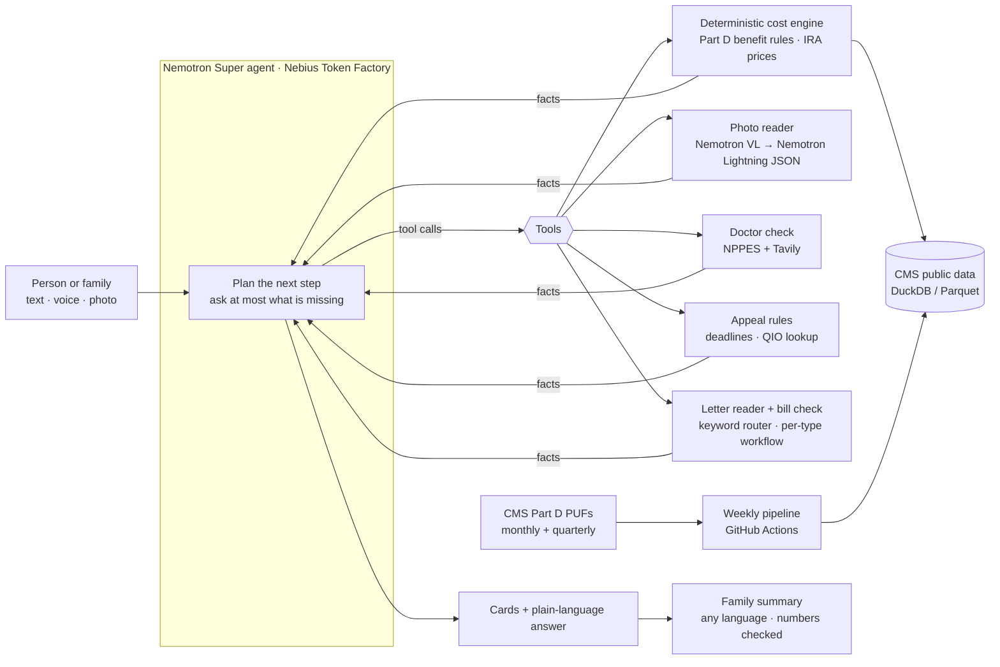

# Medicare Helper

**A neutral, privacy-first helper for people with Medicare and the families who help them.** No ads, no sign-up.
It compares every plan in a county against the medicines someone actually takes, checks their current plan for next year,
looks up doctors, screens for Extra Help, reads Medicare letters (denials, summary notices, care-ending notices) and
turns them into a deadline, steps and a drafted appeal, checks a provider's bill against the plan's statement, and
writes a short summary for the family in 18 languages.

Built for the [Nebius x NVIDIA Global AI Hackathon](https://nebiusglobalaihackathon.devpost.com/) (Best Apps and Agents
track · Best Use of Tavily). Agent and extraction run on **NVIDIA Nemotron** models served by **Nebius Token Factory**.

> Decision support only. Not an insurer, broker or enrollment service.
> Always confirm with the plan or 1-800-MEDICARE before enrolling.

**The AI never makes up a number.** Every dollar figure comes from a deterministic engine built on Medicare's public
files; the models only listen, read, extract and explain.

---

## Built on NVIDIA Nemotron + Nebius

Every answer runs through **Nebius Token Factory** at request time (OpenAI-compatible API, `NEBIUS_BASE_URL`), and the
models that make decisions are **NVIDIA Nemotron** open models:

| Job | Model on Token Factory | Why this one |
|---|---|---|
| The agent: what to ask, which tool to call, the plain-language answer | `nvidia/nemotron-3-super-120b-a12b` | Reliable tool calling at about $0.002 a turn |
| Structured extraction (pill labels, letters, bills, statements) | `nvidia/Nemotron-3_5-Lightning`, thinking off | Fast, cheap JSON: a label read went from 31 s to 8 s with thinking off |
| Family summaries in 18 languages | `nvidia/Nemotron-3-Ultra-550b-a55b` | Best at less common languages (Haitian Creole, Vietnamese); every number checked in code |
| Reading photos (transcription only) | `nvidia/Nemotron-3.5-Super-VL`, thinking off | On our 46-letter key it matched Gemma 3 27B on type and deadlines, read every key item (42/42 vs 41/42) and was faster (4.1 s vs 5.6 s per letter) |

- Every model call goes through one metered client (`src/agent/metrics.py`): task name, model, tokens and latency,
  never health content. The same counts drive a hard daily spend cap (`DAILY_SPEND_CAP_USD`).
- Deployment: Docker + Caddy on a Nebius AI Cloud VM (`deploy/`). Doctor-network leads use the Tavily Search API.

## Why

| | |
|---|---|
| **35.2M** people are in Medicare Advantage in 2026, 55% of those eligible | [KFF, 2026](https://www.kff.org/medicare/medicare-advantage-in-2026-enrollment-update-and-key-trends/) |
| **32** Medicare Advantage drug plans to choose from, on average, for 2026 | [KFF, Oct 2025](https://www.kff.org/medicare/medicare-beneficiaries-have-32-medicare-advantage-prescription-drug-plans-available-on-average-for-2026/) |
| **69%** of people with Medicare did not compare their options during open enrollment | [KFF, 2022 coverage year](https://www.kff.org/medicare/nearly-7-in-10-medicare-beneficiaries-do-not-compare-coverage-options-during-open-enrollment/) |
| **80.7%** of appealed prior-authorization denials were overturned, yet only **11.5%** were appealed | [KFF, 2024 data](https://www.kff.org/medicare/medicare-advantage-insurers-made-nearly-53-million-prior-authorization-determinations-in-2024/) |

The official tool (Medicare Plan Finder) is accurate but long and form-driven. Most help elsewhere comes from people
paid by insurers. Families end up guessing, or not choosing at all.

## What it does

1. **Tell it, or show it.** Type or speak naturally ("I take Eliquis twice a day and live in Orange County"), or take a
   photo of a pill bottle. It reads the label, matches the exact drug in RxNorm and asks only what it still needs.
2. **See the best plans for *these* medicines.** Every plan in the county, ranked by a typical year's total
   (premium + drugs + expected medical costs) and a bad year's ceiling, with star ratings, drugs not covered,
   prior-authorization / step-therapy flags, cheaper generic switches, and IRA negotiated drug prices.
3. **Check the current plan.** "Should I stay?" compares the current plan's next-year premium and out-of-pocket max
   with the best alternative, and shows the insurer's track record: how many drugs it dropped or restricted last year
   versus the national median.
4. **Keep going.** Is the doctor in network (NPPES + Tavily search of insurer directories, never claimed as certain)?
   Could they get Extra Help? What if they use mail order or have a hospital stay?
5. **Defend care.** Photo of a "Notice of Medicare Non-Coverage" → appeal deadline to the hour, the right Quality
   Improvement Organization's phone number, what to say, and what happens next.
6. **Understand any Medicare letter.** Part D and Medicare Advantage denials, Medicare Summary Notices, IRMAA
   (higher premium) letters, Annual Notices of Change: what it is, the deadline computed from the official rules
   (e.g. 65 days from the notice date for a Part D redetermination), numbered steps, how long they have to decide, and
   a drafted appeal letter plus a request for the doctor. The person fills in the medical details; the draft never
   invents them.
7. **Check a bill before paying.** Photo of the bill and of the plan's EOB (or Medicare's MSN): matched line by line,
   the overcharge shown, and a call script for the billing office. Pay what matches; ask about the rest.
8. **Keep family in the loop.** One tap writes a short summary of the results in any of 18 languages (Chinese,
   Vietnamese, Haitian Creole, Korean, Arabic, …), ready to text or email.

Plus: two modes (a big-text, one-question-at-a-time senior mode and a family mode with a people sidebar and table
view), full Spanish, a home page per person with a checklist, and a calendar file (.ics) with enrollment deadlines.

## How it works



- **Engine (`src/engine/`)**: no LLM. Implements the Part D benefit for 2026/2027 (deductible, $2,100 / $2,400
  out-of-pocket cap, $35 insulin cap), tiers and copay/coinsurance per pharmacy type, quantity limits, and the CMS
  maximum fair prices for negotiated drugs. Scoped per request to one county; most comparisons take a few seconds.
- **Agent (`src/agent/`)**: Nemotron Super with tool calling. It decides what to ask and which tool to call; it is
  instructed never to state a number that did not come from a tool, and to lead with a verdict in plain words.
- **Letters and bills (`src/letters/`)**: the router reads the official notice title with keywords (no LLM), and falls
  back to Lightning only for unknown letters. Each letter type then runs a fixed workflow: extract fields → verify
  dates and phone numbers against the transcript → compute the deadline in code → draft one argument paragraph.
  The bill check is plain code (date + description matching, amounts compared).
- **Models used**: `nvidia/nemotron-3-super-120b-a12b` (agent, letter drafts), `nvidia/Nemotron-3_5-Lightning`
  (structured extraction, thinking off), 
  `nvidia/Nemotron-3-Ultra-550b-a55b` (family summaries in other languages), `nvidia/Nemotron-3.5-Super-VL` (reading
  photos). Every model in the product is an NVIDIA Nemotron model.

### Design: workflows where we can, an agent where we must

Following Anthropic's [Building effective agents](https://www.anthropic.com/engineering/building-effective-agents):
start with the simplest thing that works and add model calls only where they earn their place.

- **Code decides, models describe.** Costs, deadlines, overcharges and plan rankings are computed in code. Models
  listen, read, extract and explain.
- **Routing without an LLM when possible.** Official notice titles are matched by keyword; the model is the fallback.
- **Prompt chaining per task.** A denial letter, a bill and a care-ending notice each have their own short, testable
  pipeline instead of one open-ended prompt.
- **Evaluator in code.** Every drafted paragraph and family summary is checked by code: any number not found in the
  facts, a promised outcome, made-up medical history, or the wrong language → one rewrite, then a plain fallback.
- **The agent loop only for the open-ended part:** the conversation, deciding what to ask and which tool to call.
- **Tools that are hard to misuse.** Exact RxNorm names only, `needs_clarification` instead of guessing a plan,
  visible step lines so people see what was checked.
- **Data (`pipeline/`)**: CMS monthly and quarterly Part D public use files, MA/PDP landscape, CMS negotiated-price
  file, 2025→2026 formulary history. Built weekly into a versioned release; the app picks up new releases on its own.
  See [docs/data-architecture.md](docs/data-architecture.md).

## Accuracy

The engine is checked against Medicare Plan Finder (`evals/`): 10 personas (generics only, insulin, specialty drugs,
polypharmacy, …) × 44 Miami-Dade plans = **440 plan estimates**.

| Metric | Result |
|---|---|
| Within 10% or $100 of Plan Finder's annual drug cost | **432 / 440 (98.2%)** |
| Coverage disagreements (drug covered vs not) | **0 / 440** |
| Priced estimates within $1 (the other 60 are coverage-only checks) | 258 / 380 |

The 8 misses: four are two stand-alone drug plans (S5921) that we underestimate, most likely because pharmacy dispensing
fees are not in the public files (see [docs/backlog.md](docs/backlog.md)); the other four are off by $105–$126 for the year. Spot check: DrSelect-CFL (HMO), Orange County FL, Eliquis + atorvastatin:
ours $0 premium + $0 drugs, $3,500 max, 4.5 stars, ranked #1; Plan Finder shows the same.

### Letters

A second answer key for the letter reader (`evals/letters/`): 46 fictional letters built on the structure of CMS's
public notice templates (Part D and Medicare Advantage denials, Medicare Summary Notices, IRMAA, care-ending notices,
plan change notices, plan non-renewal notices, EOBs, bills, plus 4 photos that are not Medicare documents). Each is printed and "photographed"
(tilted, shadowed, low light) and the right answers are computed independently of the app.

| Check | Result |
|---|---|
| Letter type recognized (incl. "not a Medicare document") | **46 / 46** |
| Deadline exactly right (appeals, plan ending Dec 31) | **33 / 33** |
| Key item read (drug, service, plan) | **42 / 42** |
| Phone number read correctly | **19 / 19** |

One of the 33 is a care-ending notice whose date is cut off in the photo: the right answer is to ask, not to guess.
The eval caught exactly that bug: the model had been inventing an end date (e.g. 2024-01-15) when none was visible.
Now a date must be found in the letter's own text, in code, before any deadline is computed.
Run: `PYTHONPATH=src python evals/letters/run_eval.py`.

### The agent

50 multi-turn conversations (`evals/agent/`): 8 used while building, 42 held out and written to break it (vague
medicines with no strength, "Dade county", two parents in one chat, an 80-year-old in senior mode who answers "I don't
know", someone typing their Medicare number, "just enroll me", insulin in units, a letter whose deadline has passed).
A simulated person answers follow-up questions from each scenario's facts. Every run is graded by code: required tool
calls and arguments, things it must and must never say, and the promises below checked in **every** reply. The model is
not deterministic, so each scenario runs 3 times.

| Set | Scenarios | Runs passed | Scenarios passing all 3 runs |
|---|---|---|---|
| dev | 8 | 24/24 | 8/8 |
| held out 1 | 14 | 42/42 | 14/14 |
| held out 2 | 14 | 42/42 | 14/14 |
| held out 3 | 14 | 41/42 | 13/14 |
| **all** | **50** | **149/150 (99%)** | **49/50** |

| Promise, checked in every reply | Held |
|---|---|
| Every $, % and star rating comes from a tool result or the user | 150/150 |
| Every dose comes from the user or a tool | 150/150 |
| Every drug name sent to the engine came from RxNorm | 150/150 |
| No internal plan keys shown | 150/150 |

**How it got there.** The held-out sets are where the bugs showed up, and most fixes moved a rule from the prompt into
code, because a prompt rule the model breaks 1 run in 10 is not a rule:

- It quoted a remembered Part B premium ($174.70, two years out of date). Now every draft reply is checked in code
  before it is sent; a number no tool returned sends it back for a rewrite.
- It dropped "[Eliquis]" from a brand the person picked, so every plan showed the drug as not covered. Picked names
  must now be used exactly.
- It ranked a drug-only plan "best" against Advantage plans, which is not a like-for-like total. They are now separate.
- It read a denial correctly but left out the appeal deadline. The deadline code computed is now always stated.
- It asked "tablet or capsule?" three times after the person said "I don't know". Form is assumed and stated.
- The last miss (m03): insulin priced as 5 pens instead of 15 mL a month. Fixed after this run with a unit check
  (50 units/day x 30 / 100 units/mL = 15 mL) that refuses the wrong quantity.

Two failures were the eval's fault ("To see if Dr. X is in network, ..." is a question, not a claim) and the eval was
fixed instead. Run: `for s in dev heldout heldout2 heldout3; do PYTHONPATH=src python evals/agent/run_agent_eval.py
--set $s --repeats 3; done; python evals/agent/summarize.py`.

## Privacy

- **No accounts, no server-side profiles.** Saved people, medicines and current plans live only in the browser
  (localStorage) and are sent with each message for that turn only.
- **No conversation logs in production** (`TRACE_LOG=0`). Uploaded photos are deleted as soon as they are read; a
  bill or statement is kept at most 30 minutes, only to compare it with the second document.
- **Reminders are opt-in** (Web Push): the server keeps only the browser's push address and the dates; the message is
  encrypted for that browser (RFC 8291) and deleted after the last date.
- **Never asks for** Medicare or Social Security numbers. Income for the Extra Help check is never saved.
- Metrics record task names, token counts and latency only, never health content.

## Cost

About **$0.002 per chat turn** at Nebius Token Factory public prices (median over logged turns; prices in
[pipeline/model_prices.json](pipeline/model_prices.json), report via `python pipeline/metrics_report.py`).
A full plan comparison is a few turns, roughly a cent, so the running cost stays small.

Guards for a public URL (`src/api/limits.py`, all set by environment variables): per-visitor limits per minute and per
day for chat, photo uploads and lookups; a site-wide cap of chat turns per day; and a hard **daily spend cap**
(`DAILY_SPEND_CAP_USD`, default $10) computed from the recorded token counts. When a cap is hit, people see a short
message pointing to 1-800-MEDICARE instead of an error.

## Run it

**Local (development)**

```bash
cp .env.example .env            # NEBIUS_API_KEY, TAVILY_API_KEY
pip install -r requirements.txt
python pipeline/build.py        # or download the latest data release (src/engine/datasync.py)
PYTHONPATH=src uvicorn api.server:app --reload --port 8000
cd web && npm install && npm run dev   # http://localhost:5173
```

**Docker (same as production)**

```bash
docker compose -f deploy/docker-compose.yml -f deploy/docker-compose.local.yml up --build   # http://localhost
```

Production runs on a small Nebius AI Cloud CPU VM behind Caddy (automatic HTTPS). See [deploy/README.md](deploy/README.md).

**Tests**: `python -m unittest discover tests` · engine accuracy: `PYTHONPATH=src python evals/run_eval.py`

## Repo layout

| Path | Contents |
| --- | --- |
| `src/engine/` | Deterministic cost engine, data access, RxNorm, Extra Help screen |
| `src/agent/` | Nemotron agent, tool definitions, family summary, metrics |
| `src/defend/` | Care-ending notice reader and appeal rules |
| `src/letters/` | Letter router, per-type rules and drafts, code evaluator, bill vs EOB/MSN check |
| `src/meds/` | Pill-bottle label reader |
| `src/network/` | Doctor / network check (NPPES + Tavily) |
| `src/api/` | FastAPI server (streaming chat, uploads) |
| `web/` | React site and app (English / Spanish, senior and family modes) |
| `pipeline/` | CMS data pipeline, negotiated prices, plan history, publishing |
| `evals/` | Personas, Plan Finder answer key, eval harness |
| `deploy/` | Docker Compose, Caddy, deployment guide |
| `docs/` | Plan, data architecture, backlog |

## Limits

- Medical costs use plan copays and out-of-pocket maximums with a typical-use estimate; drug costs are exact to the
  public files, not to a specific pharmacy's contract.
- Network status from web search is a lead to confirm with the plan, never a guarantee.
- Letter drafts are a starting point, not legal advice. Summaries in less common languages are checked for numbers and
  language, not for style; a native speaker should review them.
- Plan data is only as current as CMS's public files (refreshed weekly).

## License

MIT, see [LICENSE](LICENSE). Data: CMS public use files and NLM RxNorm (public domain / open).
